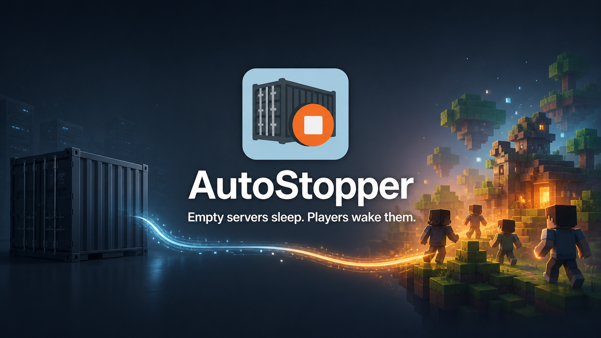

<h1 align="center">AutoStopper</h1>

<p align="center"><strong>Empty servers sleep. Players wake them.</strong></p>

<p align="center">
  Automatic, readiness-aware Docker lifecycle management for Velocity networks.
</p>

<p align="center">
  <a href="https://github.com/Criseda/AutoStopper/actions/workflows/ci.yml"></a>
  <a href="https://github.com/Criseda/AutoStopper/actions/workflows/release-candidate-e2e.yml"></a>
  <a href="#supported-runtimes"></a>
  <a href="#supported-runtimes"></a>
  <a href="https://modrinth.com/plugin/autostopper"></a>
  <a href="LICENSE"></a>
</p>

<p align="center">
  <a href="#installation">Installation</a> ·
  <a href="docs/configuration.md">Configuration</a> ·
  <a href="docs/troubleshooting.md">Troubleshooting</a> ·
  <a href="docs/migration-2.2.0-to-2.3.0.md">Migration</a> ·
  <a href="docs/releasing.md">Releasing</a> ·
  <a href="CONTRIBUTING.md">Contributing</a> ·
  <a href="CODE_OF_CONDUCT.md">Code of Conduct</a> ·
  <a href="SUPPORT.md">Support</a> ·
  <a href="SECURITY.md">Security</a> ·
  <a href="CHANGELOG.md">Changelog</a> ·
  <a href="https://modrinth.com/plugin/autostopper">Modrinth</a>
</p>

AutoStopper lets a Velocity network stop mapped Docker-based Minecraft servers when they are empty
and wake them automatically when players return. Startup waits for real Minecraft or Docker-health
readiness, simultaneous players share one lifecycle operation, and all Docker work stays off
Velocity's event and command workers.

> [!IMPORTANT]
> These instructions describe **AutoStopper 2.3.0**. Install only from the project's Modrinth or
> GitHub release pages; the examples install the pinned release from Modrinth, and a manually
> downloaded JAR should be checked against its published SHA-256 checksum. Users of 2.2.0 can read
> the [2.2.0 to 2.3.0 migration guide](docs/migration-2.2.0-to-2.3.0.md); users of 1.1.2 must
> follow the complete [1.1.2 to 2.0.0 migration guide](docs/migration-1.1.2-to-2.0.0.md) first.

## Why AutoStopper?

| | |
|---|---|
| **⚡ Wake on demand**<br>Players connect normally while AutoStopper starts a sleeping backend. | **🌙 Sleep when empty**<br>Mapped containers stop after a configurable player-free inactivity period. |
| **✓ Wait for real readiness**<br>Use Minecraft status, Docker health, or either signal—not a blind delay. | **👥 Share simultaneous startups**<br>Multiple arriving players wait on one bounded lifecycle operation. |
| **↻ Recover safely**<br>Failed stops retry with capped backoff; invalid reloads keep the prior configuration. | **◎ Diagnose quickly**<br>`/autostopper status` reports safe details and concrete operator actions. |

## Security boundary

> [!WARNING]
> **Docker socket access is host-root-equivalent.** In the examples, Velocity does not get the
> socket. A small `autostopper-docker` socket proxy holds `/var/run/docker.sock` as root and lets
> Velocity only inspect, start, and stop containers. That limits what a compromised proxy can do
> through Docker, but it can still stop or start any container on the host and read their
> environment variables, unless you pin the allowlist to your backend names. If you mount the
> socket into Velocity directly instead, any process in the proxy has full root-equivalent control
> of the Docker host.

Use a dedicated host or VM where practical, install only trusted proxy plugins, restrict host and
Compose-file access, and never publish the Docker API or the socket proxy's port. See
[Docker socket security](docs/security.md) before installing. To report a suspected vulnerability
privately, see [SECURITY.md](SECURITY.md).

## Supported runtimes

AutoStopper is one Java 21 bytecode JAR compiled against Velocity API 3.5.1. The same packaged JAR
is tested on the five runtime lines below (pull requests run Legacy, Stable 4.2, and Preview;
the release gate runs all five); keep each proxy image and Velocity build together.

| Support line | Role | Proxy image | Proxy JVM | Velocity runtime | Example |
|---|---|---:|---:|---|---|
| Legacy | Minimum supported | `itzg/mc-proxy:2026.8.0-java21` | 21 | `3.5.1`, build `615` | [`examples/velocity-legacy`](examples/velocity-legacy/) |
| Stable 4.0 | Production | `itzg/mc-proxy:2026.8.0-java25` | 25 | `4.0.0`, build `6` | [`examples/velocity-stable`](examples/velocity-stable/) (pins 4.2.0) |
| Stable 4.1 | Production | `itzg/mc-proxy:2026.8.0-java25` | 25 | `4.1.0`, build `22` | [`examples/velocity-stable`](examples/velocity-stable/) (pins 4.2.0) |
| Stable 4.2 | Production (recommended) | `itzg/mc-proxy:2026.8.0-java25` | 25 | `4.2.0`, build `30` | [`examples/velocity-stable`](examples/velocity-stable/) |
| Preview | Snapshot validation | `itzg/mc-proxy:2026.8.0-java25` | 25 | `4.2.1-SNAPSHOT`, build `41` | [`examples/velocity-preview`](examples/velocity-preview/) |

The legacy line is the tested minimum; the stable lines (4.0, 4.1, and 4.2) are production runtimes, with 4.2 recommended.
Velocity 4.x requires at least Java 25, so do not run the stable or preview builds on Java 21.
Velocity 4.2.1 is currently supplied by PaperMC as a snapshot and is validated only as preview, not
as a production baseline. The release-candidate stack is tested with Purpur 1.21.4; backend Java
is independent of the proxy JVM. AutoStopper observes Velocity API events and a generic Minecraft
status request rather than backend-specific APIs, so it is compatible with Minecraft Java Edition
1.7.2 through 26.2 when used through a supported Velocity runtime; only the listed backend is
directly exercised. Other Velocity, Java, proxy-image, and backend combinations are not part of the
tested matrix.

### Compatibility canary

AutoStopper is supported on the exact stable runtime lines listed above. Newer stable and preview
Velocity builds are tested automatically by the weekly
[Velocity compatibility canary](https://github.com/Criseda/AutoStopper/actions/workflows/velocity-compatibility-canary.yml)
against both the latest public release JAR and a fresh `master` build. A green canary is evidence
of observed compatibility, not a blanket guarantee for future versions. Preview/snapshot builds
remain best-effort. Dated observations may be noted here by the maintainer after sustained green
runs; a canary failure that needs a code change ships in a new AutoStopper release and never
rewrites an existing one.

## Installation

You need a Linux host with Docker Engine and Docker Compose v2. The steps below set up the
recommended stable line: Velocity 4.2.0 on Java 25, with one Minecraft server that AutoStopper puts
to sleep and wakes. They need no custom entrypoint, no host-specific values, and nothing to
download by hand.

### 1. Create `docker-compose.yml`

Make an empty directory and save this as `docker-compose.yml` in it:

```yaml
services:
  # Lets Velocity inspect, start and stop containers, and nothing else.
  # It is the only service that touches the Docker socket.
  autostopper-docker:
    image: wollomatic/socket-proxy:1.13.1@sha256:3935b709275e4ec35d6ed5a5c4a1f0d01ed31eec5e7234efc3357ecd47689002
    restart: unless-stopped
    user: "0:0"
    read_only: true
    cap_drop:
      - ALL
    command:
      - -listenip=0.0.0.0
      - -allowfrom=velocity
      - -allowGET=^(/v[0-9.]+)?/(_ping|containers/[a-zA-Z0-9_.-]+/json)$
      - -allowPOST=^(/v[0-9.]+)?/containers/[a-zA-Z0-9_.-]+/(start|stop)$
    volumes:
      - /var/run/docker.sock:/var/run/docker.sock:ro
    networks:
      - autostopper-internal

  velocity:
    image: itzg/mc-proxy:2026.8.0-java25
    environment:
      TYPE: "VELOCITY"
      VELOCITY_VERSION: "4.2.0"
      VELOCITY_BUILD_ID: "30"
      # Installs AutoStopper from Modrinth at startup. MINECRAFT_VERSION only
      # selects the download (any version from 1.7.2 to 26.2 works).
      MODRINTH_PROJECTS: "autostopper:2.3.0"
      MINECRAFT_VERSION: "1.21.4"
    ports:
      - "25565:25577"
    volumes:
      - ./velocity_server:/server
    networks:
      - minecraft
      - autostopper-internal
    depends_on:
      - autostopper-docker
    restart: unless-stopped

  # A server AutoStopper manages. Add more the same way.
  survival:
    image: itzg/minecraft-server:java21
    container_name: survival-server
    environment:
      EULA: "TRUE"
      TYPE: "PURPUR"
      VERSION: "1.21.4"
      ONLINE_MODE: "FALSE"
    volumes:
      - ./survival_data:/data
    networks:
      - minecraft
    restart: "no"          # AutoStopper starts and stops it; Docker must not restart it
    stop_grace_period: 60s # time to save the world when it is stopped

networks:
  minecraft:
  autostopper-internal:
    internal: true
```

The same file, with two servers and for the Java 21 / Velocity 3.5.1 and preview lines, is in
[`examples/`](examples/). Do not mix images and Velocity builds between lines.

### 2. Start it

```sh
docker compose up -d
```

The first start downloads Velocity, AutoStopper, and the Minecraft server, and generates their
configuration under `velocity_server/` and `survival_data/`.

### 3. Tell Velocity about the server

In `velocity_server/velocity.toml`, replace the sample servers and the sample forced hosts, which
refer to them:

```toml
[servers]
survival = "survival:25565"
try = ["survival"]

[forced-hosts]
```

In the `[advanced]` section of the same file, give a sleeping server time to wake before Velocity
gives up on the waiting player (the default is 30 seconds):

```toml
read-timeout = 180000
```

### 4. Tell AutoStopper which container belongs to it

In `velocity_server/plugins/autostopper/config.yml`, replace `monitored_servers: []` with:

```yaml
monitored_servers:
  - server_name: survival            # the name in velocity.toml
    container_name: survival-server  # the container_name in docker-compose.yml
```

### 5. Restart Velocity and check

```sh
docker compose restart velocity
docker compose logs velocity | grep -i autostopper
```

Look for these two lines:

```text
Docker Engine API endpoint: endpoint auto: tcp://autostopper-docker:2375 (socket-proxy sidecar)
AutoStopper startup preflight healthy: 1 mapping(s) checked.
```

That's it. After 5 minutes without players, AutoStopper stops `survival-server`. The next player
who joins wakes it: they see short progress messages and are connected as soon as it answers. In
game or on the console, `/autostopper status` shows each server's state.

### Next steps

- **More servers:** add a service with `restart: "no"`, a `[servers]` entry, and a mapping. Always-on
  hubs or lobbies stay out of `monitored_servers` and may keep `restart: unless-stopped`.
- **Tuning:** inactivity timeout, readiness checks, and stop retries are in the
  [configuration reference](docs/configuration.md). Large or modded worlds may need a longer
  `stop_grace_period`; AutoStopper waits for it.
- **Upgrades:** change the version in `MODRINTH_PROJECTS` and run `docker compose up -d`. The old
  JAR is removed automatically. The proxy contacts Modrinth on every start, so it cannot start
  while Modrinth is unreachable.
- **Manual install:** remove `MODRINTH_PROJECTS` and `MINECRAFT_VERSION`, and put the unchanged JAR
  from [GitHub Releases](https://github.com/Criseda/AutoStopper/releases) at
  `velocity_server/plugins/AutoStopper.jar`. Use one method only: with both, Velocity loads
  whichever copy it finds first and refuses the other.
- **Upgrading from 2.2.0:** the JAR is a drop-in replacement, and the
  [migration guide](docs/migration-2.2.0-to-2.3.0.md) shows how to move an entrypoint deployment to
  the socket proxy. These steps need AutoStopper 2.3.0 or newer; for 2.2.0 or earlier, use the
  [examples from that release](https://github.com/Criseda/AutoStopper/tree/2.2.0/examples).
- **Something wrong?** See [troubleshooting](docs/troubleshooting.md).

### Alternatives

The socket proxy is the recommended setup and the only one that needs no host-specific values.
AutoStopper also works without it; see [Docker access](docs/configuration.md#docker-access) for how
it finds Docker.

- **Mount the socket into Velocity.** This needs the host's socket group ID and a one-time
  ownership change, and gives Velocity host-root-equivalent access. See
  [Direct socket mount](docs/security.md#direct-socket-mount).
- **Velocity outside Docker.** Run the proxy as a user in the `docker` group. AutoStopper uses
  `/var/run/docker.sock`, or `DOCKER_HOST` when it is a `unix://` or plain `tcp://` address.
- **The Docker CLI backend.** Set `docker.backend: cli` when the daemon is reached in a way the
  Engine API backend does not support, such as `ssh://` or TLS. The proxy then needs the `docker`
  CLI. This backend is deprecated and planned for removal in 3.0.0.

## Behavior

- A connection to a monitored server is held while AutoStopper inspects or starts its mapped
  container and completes the configured readiness check. Simultaneous players share that work.
- Waiting players receive clean, branded lifecycle messages moving through inspection, waking,
  readiness, and connection (`AutoStopper › Waking survival…`). Late arrivals see the current stage
  and waiter count, while terminal success/failure includes the elapsed wait time. AutoStopper does
  not send periodic percentage spam.
- Operational status distinguishes a merely running container (`Running · readiness unverified`) from
  a backend whose readiness has succeeded in the current lifecycle generation (`Ready`). Active
  `Waking` and `Stopping` transitions remain authoritative; otherwise current Docker observation
  overrides stale quiescent lifecycle state.
- A connection to an unmonitored Velocity server proceeds normally; AutoStopper never infers a
  container name and never manages it.
- The inactivity scan runs once per minute. A mapped, running server with no players is stopped
  after its configured inactivity period.
- Failed and timed-out automatic stops retain activity and use bounded exponential retry. After the
  attempt limit, a new retry cycle requires another full inactivity period.
- A successful reload atomically replaces the configuration and runs a Docker mapping preflight. A
  malformed or invalid reload is rejected in full and the previous snapshot remains active.
- Proxy shutdown cancels plugin work within `shutdown_timeout_seconds`; it does not stop managed
  Minecraft containers.

See the [configuration reference](docs/configuration.md),
[troubleshooting guide](docs/troubleshooting.md), and [message style guide](docs/message-style-guide.md)
for the complete contract.

## Commands and permissions

| Command | Required permission | Notes |
|---|---|---|
| `/autostopper`, `/as` | None | Shows the version, tagline, and Docs, GitHub, Modrinth, and Changelog links. |
| `/autostopper help` | None | Lists the commands the source may use, grouped by purpose, with click-to-suggest and a permission hover for players. |
| `/autostopper status [server]` | `autostopper.command.status` or `autostopper.admin` | Without a server, shows one row per mapped backend; players click a row for its detail. With a server, shows its state and startup stage, hold, waiting players, activity, last failure with cause and fix, and recent lifecycle operations. |
| `/autostopper reload` | `autostopper.command.reload` or `autostopper.admin` | Atomically validates, applies, and preflights the new configuration. |
| `/autostopper start <server>` | `autostopper.command.start` or `autostopper.admin` | Starts the mapped backend container and awaits verified readiness. |
| `/autostopper stop <server>` | `autostopper.command.stop` or `autostopper.admin` | Stops the mapped backend container; refused if players or waiters are present. |
| `/autostopper restart <server>` | `autostopper.command.restart` or `autostopper.admin` | Atomically stops (if running), starts, and awaits readiness for the mapped server. |
| `/autostopper hold <server>` | `autostopper.command.hold` or `autostopper.admin` | Sets a runtime hold suppressing automatic inactivity shutdown. |
| `/autostopper release <server>` | `autostopper.command.release` or `autostopper.admin` | Releases an active runtime hold, resuming normal inactivity evaluation. |

`autostopper.admin` is an explicit umbrella. If it is granted, it authorizes all restricted
commands even when a command-specific node is not granted. Automatic starts and stops have no
player permission node; normal Velocity connection rules still apply. AutoStopper does not register
or replace `/server` and does not check or change `velocity.command.server`. All operator lifecycle
operations route strictly through the shared coordinator and validate empty-server invariants.

## Building and verification

Builds require JDK 21 through 25. The committed Maven Wrapper pins Maven 3.10.0 and is the canonical
entry point:

```sh
./mvnw --batch-mode --no-transfer-progress clean verify
```

```powershell
.\mvnw.cmd --batch-mode --no-transfer-progress clean verify
```

The verified shaded JAR is written under `target/`. The optional packaged-runtime and live
release-candidate gates are documented in [`smoke/README.md`](smoke/README.md) and
[`e2e/README.md`](e2e/README.md).

## Development workflow

`master` is AutoStopper's sole authoritative development and release branch. All changes use
short-lived branches and pull requests; the former long-lived `dev` flow is retired. Required
checks, review and merge rules, branch cleanup, hotfixes, version ownership, tag points, and the
historical `dev`/`master` reconciliation are documented in
[`CONTRIBUTING.md`](CONTRIBUTING.md). The protected, byte-identical GitHub and Modrinth publication
flow is documented in [`docs/releasing.md`](docs/releasing.md).

## License and credits

AutoStopper is licensed under the [MIT License](LICENSE). It uses the
[`itzg/mc-proxy`](https://github.com/itzg/docker-mc-proxy) and
[`itzg/minecraft-server`](https://github.com/itzg/docker-minecraft-server) container projects.
